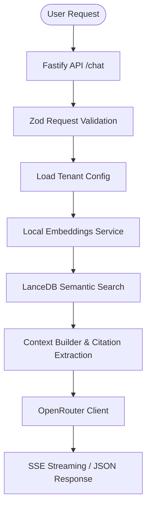

# Multi-Tenant AI RAG Backend

A production-ready, multi-tenant Retrieval-Augmented Generation (RAG) backend built using **Node.js**, **TypeScript**, **Fastify**, **LanceDB**, **Xenova Transformers** (local embeddings), and **OpenRouter**.

This backend operates completely independently of the frontend, offering a set of REST APIs to query, index, and re-index arbitrary website domains.

---

## 🏗️ System Architecture



### Flow Breakdown
1. **Web Crawler**: Crawls sitemaps or recursively parses internal HTML pages of a target website.
2. **Content Extraction**: Strips site elements like navigation, headers, footers, scripts, and cookies, formatting headings, paragraphs, lists, and tables into markdown.
3. **Chunking Engine**: Breaks text into ~500-800 word chunks respecting sentence boundaries, with a ~100-word overlap.
4. **Embeddings Engine**: Generates 384-dimensional dense vectors locally using `@xenova/transformers` with the `Xenova/all-MiniLM-L6-v2` model.
5. **Vector Store**: Isolates site data using LanceDB sub-directories (`vectors/<siteId>/`) for tenant isolation.
6. **Chat API**: Queries local vectors, builds a prompt restricting responses strictly to context, fetches OpenRouter completions, and streams responses with citations.

---

## 🛠️ Tech Stack
- **Core**: Node.js & TypeScript
- **Web Framework**: Fastify
- **Vector DB**: LanceDB (stored locally)
- **Local Embeddings**: `@xenova/transformers` (`all-MiniLM-L6-v2`)
- **LLM API**: OpenRouter
- **Parsing/Scraping**: Cheerio & Axios
- **Security**: Cors, Helmet, and Rate-Limiter plugins

---

## 📁 Directory Structure
```
├── config/              # Server configuration and environment schema validation
├── sites/               # Tenant JSON configuration files (e.g. sanjivani.json)
├── vectors/             # Local LanceDB storage directories (site-isolated)
├── src/
│   ├── api/
│   │   ├── middleware/  # Security, rate-limiting, and CORS configurations
│   │   └── routes/      # Chat, Health, and Reindex endpoints
│   ├── crawler/         # Crawler and DOM content cleaners
│   ├── embeddings/      # ONNX local embedding model pipeline
│   ├── prompts/         # Strict system prompt templates
│   ├── services/        # OpenRouter client and RAG coordinators
│   ├── vector/          # LanceDB vector operations wrapper
│   ├── utils/           # Structured logging utility
│   ├── scripts/         # CLI indexing runner
│   └── index.ts         # Fastify bootstrapping entrypoint
```

---

## 🚀 Getting Started

### 1. Prerequisites
Ensure you have Node.js (version 18 or above) installed.

### 2. Installation
Install the project dependencies:
```bash
npm install
```

### 3. Setup Configuration
Copy the sample environment file and configure your API key:
```bash
cp .env.example .env
```
Edit `.env` and add your **OpenRouter API Key**:
```env
OPENROUTER_API_KEY=your_openrouter_api_key_here
OPENROUTER_MODEL=meta-llama/llama-3-8b-instruct:free
PORT=3000
HOST=0.0.0.0
```

---

## 📂 Multi-Tenant Configuration
To support a new website, create a JSON configuration file under `sites/<siteId>.json`.

For example, to configure **Sanjivani Hospital**, `sites/sanjivani.json` contains:
```json
{
  "siteId": "sanjivani",
  "url": "https://hospitalsanjivani.in",
  "name": "Sanjivani Hospital"
}
```

---

## 🖥️ Command Line Scripts

### Index a Website (Local Embedding)
Crawl a tenant's website, split it into chunks, embed it locally, and write to its LanceDB table:
```bash
# Indexes the default tenant ("sanjivani")
npm run index

# Index a specific tenant with a page crawl limit
npm run index -- --siteId=sanjivani --maxPages=50
```

### Re-index a Website
Updates the local vector database folder with fresh crawler content:
```bash
npm run reindex -- --siteId=sanjivani
```

### Run Server in Development Mode
Starts the Fastify API with hot reloading enabled via `tsx`:
```bash
npm run dev
```

---

## 🌐 API Reference

### 1. Health Check
Checks if the server is alive.
* **URL**: `/health`
* **Method**: `GET`
* **Response**:
```json
{
  "status": "ok",
  "timestamp": "2026-07-19T16:20:00Z",
  "env": "development"
}
```

### 2. Re-index Tenant (Background Task)
Triggers the crawler and re-indexes a website. Returns immediately to prevent client timeouts.
* **URL**: `/reindex`
* **Method**: `POST`
* **Body**:
```json
{
  "siteId": "sanjivani"
}
```
* **Response (202 Accepted)**:
```json
{
  "status": "accepted",
  "message": "Re-indexing initiated for siteId: \"sanjivani\" in the background."
}
```

### 3. Chat Endpoint
Queries the tenant's vector database, retrieves the top 5 chunks, constructs a restricted prompt context, and obtains a completion.

* **URL**: `/chat`
* **Method**: `POST`
* **Body**:
```json
{
  "siteId": "sanjivani",
  "message": "Who is the dermatologist?",
  "stream": false
}
```
* **Response (Standard JSON)**:
```json
{
  "answer": "The dermatologist at Sanjivani Hospital is Dr. Amit Shah.",
  "sources": [
    {
      "title": "Sanjivani Hospital Doctors List",
      "url": "https://hospitalsanjivani.in/doctors"
    }
  ]
}
```

#### Streaming Mode (Server-Sent Events)
If `"stream": true` is passed:
1. Returns headers with `Content-Type: text/event-stream`.
2. Emits a `sources` event detailing the search citations:
   `data: {"type":"sources","sources":[{"title":"Doctors","url":"https://..."}]}`
3. Emits `token` events as words arrive:
   `data: {"type":"token","content":"The"}`
   `data: {"type":"token","content":" dermatologist"}`
4. Emits a termination signal:
   `data: {"type":"done"}`

---

## ☁️ Deployment Guide (Render)

This project is configured to compile to native JS and deploy directly to **Render** (or any Node.js hosting platform).

### Setup steps:
1. Connect your Github repository to a **Web Service** on Render.
2. Select the **Node** runtime.
3. Configure build and start commands:
   - **Build Command**: `npm install && npm run build`
   - **Start Command**: `npm start`
4. Add environment variables in the Render Dashboard:
   - `NODE_ENV=production`
   - `PORT=10000` (Render binds this automatically)
   - `OPENROUTER_API_KEY` = *[Your OpenRouter API Key]*
   - `OPENROUTER_MODEL` = *[Model Name, e.g. meta-llama/llama-3-8b-instruct:free]*
5. **Persistent Disk (Optional but Recommended)**:
   - By default, LanceDB saves database files under `vectors/` inside the local container filesystem. Since Render instances are ephemeral, any indexing will be wiped on restart.
   - To make indexing persistent, add a **Render Persistent Disk** mounted at `/opt/vectors` (size: 1GB is more than enough).
   - In your Render configuration environment variables, set a variable if needed or symlink `vectors` to the mount directory. Or simply modify `VectorStore.ts` base path or use environment configurations. To support this natively, we use relative `vectors/` paths which work automatically. If mounting a volume, mount it at the path where the project is run (e.g. `/opt/render/project/src/vectors`).
