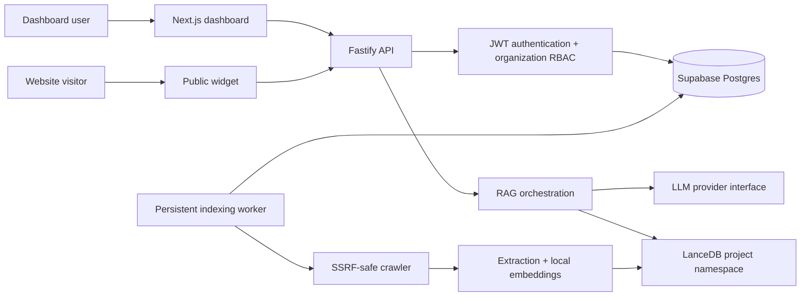

# MVP delivery roadmap

This document is the source of truth for product scope. Update the status and acceptance evidence whenever a milestone changes.

## Product boundary

The MVP lets a business create a project, add a website it controls, index public website content, test an assistant, and install a public widget. The product is not an autonomous agent, appointment system, WhatsApp integration, billing platform, or enterprise support suite yet.

## Target architecture

Postgres is the system of record. LanceDB holds only derived, per-project retrieval data on persistent VPS storage. The public widget has no administrative credential and accesses only its own public assistant identifier.

## Delivery board

| Milestone | Status | What is included | Exit criteria |
| --- | --- | --- | --- |
| 0. Existing RAG backend | Complete | Crawl, extraction, chunking, local embeddings, LanceDB retrieval, OpenRouter answers, SSE | Current TypeScript build passes |
| 1. SaaS database foundation | Complete | Prisma schema, initial migration, environment validation, local Postgres Compose recipe | `npm run build` and Prisma validation pass |
| 2. Identity and tenant authorization | Implemented; DB verification pending | Registration/login, JWT validation, organization membership, project authorization | Cross-tenant access tests pass; legacy admin indexing cannot run in production |
| 3. Secure website ingestion | Implemented; live DB verification pending | Website ownership proof, DNS/private-address/redirect checks, persistent jobs, status, retry by re-enqueue, queued-job cancellation, per-website vectors | Restart-safe job and crawler-security tests pass |
| 4. Public chat and usage controls | Planned | Public assistant IDs, origin checks, rate limits, usage/cost ledger, provider abstraction | A public widget can only retrieve its own project data |
| 5. Dashboard and widget | Planned | Next.js dashboard, project setup, status, test chat, install snippet, lightweight widget | A pilot customer completes setup without operator help |
| 6. Operations and pilot readiness | Planned | Docker deployment, backups/restore drill, monitoring, CI, load/failure tests | One real pilot passes an operational checklist |

## What exists today

- The legacy single-site pipeline reads configuration from `sites/*.json` and indexes `vectors/<siteId>`.
- PostgreSQL models now exist for users, organizations, projects, websites, assistants, jobs, API-key metadata, conversations, and usage events.
- The backend does **not** yet use those models for its existing chat or indexing routes.

## Deliberately deferred

- Paid subscriptions and payment processing
- Teams beyond owner/admin/member roles
- File uploads, WhatsApp, booking, and CRM integrations
- Advanced analytics and enterprise SSO
- Replacing LanceDB or adding Kubernetes

## Operating decisions

- Use Supabase Postgres for the system of record; use a server-side pooled connection string and never expose it to a browser.
- Use a paid Gemini tier for customer traffic containing visitor messages. Free-tier content may be used to improve provider products, so it is development-only for public/non-sensitive test data.
- Start with one VPS for the API, worker, local model, and LanceDB. Back up Postgres separately and persist the LanceDB directory.

## Immediate next checks

1. Finish Milestone 2 and test organization isolation.
2. Create the Supabase project, a dedicated Prisma role, and apply `npm run db:migrate`.
3. Implement website ownership verification and hardened ingestion before enabling customer-controlled URLs.
